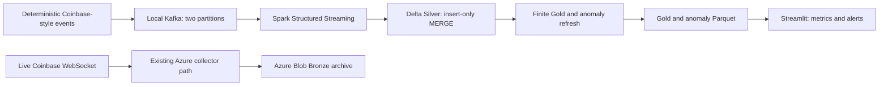
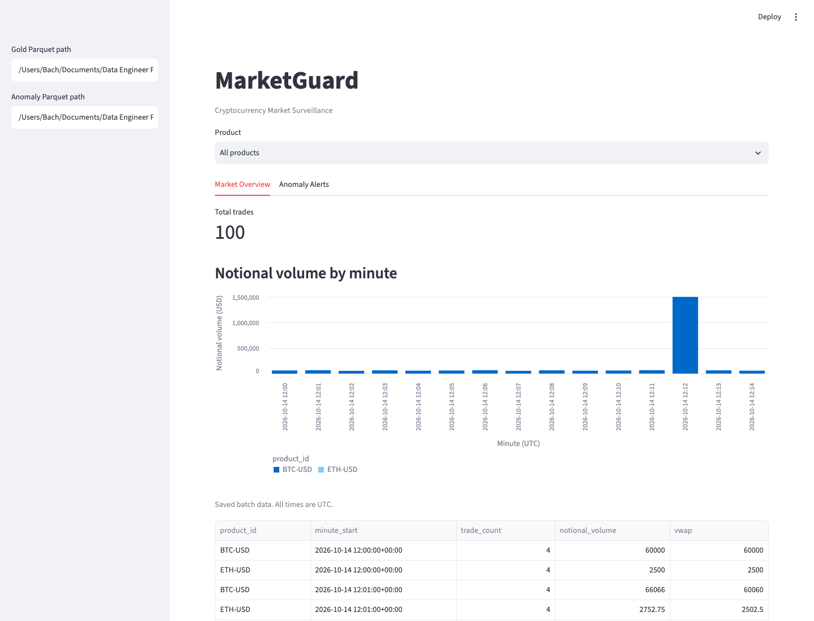

# MarketGuard

Repository: https://github.com/bachnguyennn/Market-Guard

## Publish analytics snapshots to Azure

The publisher provides **local analytics → private Blob snapshots**. Publishing
alone does not switch the website's data source; configure the read-only Azure
connection below. It does not start collection, create compute resources, or
enable scheduled refreshes. The existing immutable
Bronze upload path remains unchanged.

From the project directory, with the full pipeline environment installed:

```sh
.venv/bin/python scripts/publish_dashboard.py --export-only
az login
.venv/bin/python scripts/publish_dashboard.py
```

The publisher reads `data/batch_output/gold` and `data/batch_output/anomalies`,
validates schemas and matching unique product/minute keys, and creates
`data/dashboard_export/gold.parquet` and `anomalies.parquet`. Only known analytics
columns are exported. Decimal values and UTC timestamps are preserved. Use
`--input-dir <analytics-output-dir>` and `--export-dir <separate-export-dir>`
for other saved outputs; input and export directories must not overlap.

Unless `--export-only` is supplied, it authenticates using `DefaultAzureCredential`
and publishes to `https://stmarketguard3b4d59fa.blob.core.windows.net`:

- Private container: `dashboard` (created if absent; existing public containers are rejected).
- Replaceable blobs: `latest/gold.parquet` and `latest/anomalies.parquet`.
- Each upload uses overwrite and is downloaded again for byte-for-byte verification.
- `latest/snapshot.json` is uploaded last, with byte counts and SHA-256 hashes of both files.
- Failures exit unsuccessfully; only a fully verified pair produces `published: true`.

Your signed-in identity needs storage data-plane access, typically
**Storage Blob Data Contributor** at the appropriate scope. Account Owner or
Contributor alone does not necessarily grant blob data access. See Microsoft's
[passwordless setup](https://learn.microsoft.com/en-us/azure/storage/blobs/storage-quickstart-blobs-python)
and [blob upload documentation](https://learn.microsoft.com/en-us/azure/storage/blobs/storage-blob-upload-python).
No storage account key or SAS is embedded in this publisher. Standard storage
and request usage applies to the existing Azure account.

The two blob overwrites are **not atomic as a pair**. The dashboard checks both
files against the manifest before displaying either. In-progress, partial, or
concurrent overwrites fail closed instead of combining different snapshots.
This can temporarily show an error while publishing; immutable versioned blob
paths would improve availability later. A single publisher is still recommended.

Inspect the published objects without printing credentials:

```sh
az storage blob list \
  --account-name stmarketguard3b4d59fa --container-name dashboard \
  --auth-mode login \
  --query "[].{Name:name,Modified:properties.lastModified}" --output table
```

The publisher reports the **latest market minute in the source data**, not a
claim that collection is running. Zero alerts is a valid result; the existing
small batch output may not contain enough history for statistical alerts.
The first verified Azure publication contained two Gold rows, two evaluated
anomaly rows, and zero flagged alerts, with latest market minute
`2026-10-14 21:35 UTC`. Both uploaded blobs were downloaded and matched the
local exports byte-for-byte; the destination container was checked as private.
Exports remain ignored by Git. SAS rotation and scheduled analytics refreshes
are not automated. Never put SAS tokens in source control or logs.

```sh
.venv/bin/python -m pytest tests/test_dashboard_publisher.py -v
```

## Manually refresh analytics from Azure Bronze

The **Refresh dashboard analytics** GitHub Actions workflow rebuilds
`Azure Bronze → local Spark Silver → Gold → anomalies → dashboard snapshots`.
It is manual-only: no schedule is enabled, the collector is not redeployed,
and no new cloud compute resources are created. GitHub runner time and existing
Azure storage/download/request charges can still apply.

### One-time GitHub and Azure setup

1. Commit and push `src/refresh_analytics.py`,
   `.github/workflows/refresh-analytics.yml`, its tests, and this README to `main`.
   The workflow deliberately runs only from `main`.
2. In **GitHub repository → Settings → Secrets and variables → Actions**, reuse
   the existing `AZURE_CLIENT_ID`, `AZURE_TENANT_ID`, and
   `AZURE_SUBSCRIPTION_ID` repository secrets from the collector deployment.
   These identify the Azure identity; do not add an account key, client secret,
   or dashboard SAS to this workflow.
3. Confirm that identity's Azure federated credential trusts this repository's
   `main` branch. The workflow uses `azure/login` with GitHub OIDC, then
   `DefaultAzureCredential` uses the authenticated Azure CLI session. See
   [GitHub's Azure OIDC setup](https://docs.github.com/en/actions/how-tos/secure-your-work/security-harden-deployments/oidc-in-azure).
4. In the Azure portal, open the existing storage account's containers. Under
   each container's **Access control (IAM)**, grant that same identity:
   - `bronze`: **Storage Blob Data Reader**.
   - `dashboard`: **Storage Blob Data Contributor**.
   Keep `dashboard` private. Management-plane Contributor alone is insufficient.
   An administrator may need to assign these roles; allow time for propagation.

### First dry run, then publish

1. Open **GitHub → Actions → Refresh dashboard analytics → Run workflow**.
2. Select `main`, keep the six-hour lookback, and leave **publish unchecked**.
   This downloads recent Bronze, runs the existing verified batch pipeline,
   exports validated Parquet locally, and checks the current dashboard snapshot.
   It performs no Azure writes.
3. After the job succeeds, download its `analytics-refresh-summary` artifact.
   Check `silver_count`, `gold_rows`, `alert_count`, `latest_market_minute`,
   and `published: false`. Only the count/time summary is uploaded as an
   artifact, not raw trades, credentials, or local Parquet datasets.
4. Run it again with **publish checked**. A successful report must say
   `published: true`. The publisher verifies uploaded bytes, commits the hash
   manifest last, then the refresh verifies dashboard read-back counts.
5. Open the public website and click **Refresh Azure data**. Confirm the source
   is Azure and the displayed latest market minute matches the report.

For a local run, use the full pipeline environment, Java 17, and your Azure login:

```sh
az login
.venv/bin/python -m marketguard.refresh_analytics
.venv/bin/python -m marketguard.refresh_analytics --publish
.venv/bin/python -m pytest tests/test_refresh_analytics.py -v
```

Local staging is under ignored `data/analytics_refresh/run_*`; the successful
summary is `data/analytics-refresh-summary.json`. Each run uses a separate
directory. Old local runs can be removed after inspection; never delete Azure
Bronze as part of this cleanup. The workflow pins its tested Spark/Delta and
dashboard dependencies and retains summary artifacts for seven days.

### Bounds and limitations

- The default window is the last **six hours of blob ingestion timestamps**,
  not a full-history or event-time incremental rebuild. `--lookback-hours`
  accepts 1–24 locally; the workflow offers 6, 12, or 24. Totals can decrease
  as old batches leave this rolling window.
- Bronze filenames are UUID-based, not date-partitioned. Azure must still list
  the `coinbase/` prefix to filter metadata; downloads alone are windowed.
  See [Azure's listing API](https://learn.microsoft.com/en-us/azure/storage/blobs/storage-blobs-list-python).
- Each run allows at most 50,000 scanned blobs, 10,000 selected JSONL batches,
  and 128 MiB of source data, with eight download workers. Exceeding a bound
  fails before publication rather than silently dropping batches. Eventually
  date-partitioned Bronze or a persisted cursor will be needed.
- Listed ETags and byte counts are checked during downloads. Empty input,
  failed downloads, invalid analytics, and market timestamps older than the
  published snapshot prevent publication. Upload failures propagate; two
  snapshot replacements are still not an atomic transaction and can temporarily
  make the dashboard reject the pair until a successful retry.
- GitHub serializes this workflow's refreshes. Do not run another publisher
  concurrently. The 25-minute job timeout bounds runner work; a timeout during
  publishing may require a new successful run to restore a matched snapshot.
- Rolling detectors still require sufficient consecutive historical minutes.
  Window-edge/partial-minute collection is not an ingestion-health guarantee,
  and a statistical alert is not proof of fraud.

Scheduling is intentionally deferred until a manual dry run and publication
both succeed in GitHub. Dashboard SAS renewal is **still manual**: refreshing
analytics does not extend the read-only token in Streamlit Secrets.

## Connect the public dashboard to Azure

Push the updated reader, publisher, dashboard requirements, and entry points to
GitHub. Keep the Community Cloud main file at `deploy/streamlit_app.py` and
Python at `3.12`. The dashboard environment adds only `azure-storage-blob`;
it does not require Azure Identity, Spark, Delta, or Kafka.
The canonical pinned dependency list is `deploy/requirements.txt`, next to the
Cloud entry point; `requirements-dashboard.txt` includes it for local installs.
Make sure the Cloud deployment rebuilds its environment after these changes.

1. Run the publisher again so `latest/snapshot.json` exists beside both Parquet
   files. Old publications without a manifest are deliberately rejected.
2. Generate a short-lived, HTTPS-only **read-only container SAS** locally using
   your Azure login. Run the following yourself; its output is a secret, not
   something to paste into chat, a GitHub issue, or a commit:

```sh
EXPIRY=$(.venv-dashboard/bin/python -c 'from datetime import UTC, datetime, timedelta; print((datetime.now(UTC) + timedelta(days=1)).strftime("%Y-%m-%dT%H:%MZ"))')
az storage container generate-sas \
  --account-name stmarketguard3b4d59fa --name dashboard \
  --permissions r --https-only --expiry "$EXPIRY" \
  --auth-mode login --as-user --output tsv
```

The reader knows the three blob paths, so list permission is unnecessary;
`rl` also works, but write/delete permissions and account keys are rejected.
Creating a user-delegation SAS requires permission to generate a delegation
key at the storage-account scope. If denied, ask an administrator for narrowly
scoped access rather than using an account key. See Microsoft's
[user-delegation SAS guidance](https://learn.microsoft.com/en-us/azure/storage/blobs/storage-blob-user-delegation-sas-create-cli).

3. In Community Cloud app settings, add the following through **Secrets**,
   replacing only the placeholder with the token. A safe template is also in
   `deploy/azure-secrets.example.toml`.

```toml
[azure]
account_url = "https://stmarketguard3b4d59fa.blob.core.windows.net"
container = "dashboard"
sas_token = "YOUR_READ_ONLY_CONTAINER_SAS"
```

See [Streamlit secrets management](https://docs.streamlit.io/deploy/streamlit-community-cloud/deploy-your-app/secrets-management).
For local testing, put the actual values in ignored `.streamlit/secrets.toml`.
Do not edit the versioned template with a real token. No token is generated or
stored by this repository's setup scripts.

4. Reload the website. An `[azure]` section selects Azure automatically. With
   no section, the clearly labeled bundled synthetic demo remains available.
   A partial/expired/invalid Azure configuration or failed download shows a
   clear error and does **not** silently fall back to demo data.

The reader validates both Parquet schemas, unique matching minute/product keys,
and manifest hashes, preserving Decimal values and UTC timestamps. Both tables
share one 60-second in-memory cache entry. Token rotation changes the cache key;
expired tokens are checked even before cache hits. **Refresh Azure data** clears
the cache and reruns the page. The cache TTL alone does not trigger page reruns,
run the analytics pipeline, or publish new observations.

The website reports the latest **market minute from Gold**, snapshot publication
time, download time, and source-data age separately. Data over 30 minutes old
gets a warning; that threshold is a display safeguard, not an ingestion SLA.
It never labels stored data as a continuous live feed or claims the collector
is running. SAS tokens expire after the requested day: rotate the secret before
expiry. Durable renewable authentication and scheduled refreshes remain future
work; no collector, scheduling, or production infrastructure is changed here.

```sh
.venv/bin/python -m pytest tests/test_azure_dashboard.py tests/test_dashboard_publisher.py tests/test_public_dashboard.py tests/test_public_deployment.py tests/test_dashboard.py tests/test_dashboard_data.py -v
```

## Public dashboard deployment

Without Azure secrets, the public website uses a bundled **synthetic, precomputed
snapshot**, not a live Coinbase feed. It shows 100 trades across 15 minutes per pair,
30 Gold buckets, a BTC volume alert, and an ETH price alert. Kafka, Spark,
Delta, and Azure run separately and are not needed on the dashboard server.
No Azure credentials are required for that demo mode. Visitors cannot
enter server filesystem paths; the original local dashboard still supports
its existing path controls and environment settings.

To test the public entry point in a lightweight environment:

```sh
python -m venv .venv-dashboard
.venv-dashboard/bin/python -m pip install -r requirements-dashboard.txt
.venv-dashboard/bin/python -m streamlit run streamlit_app.py
```

Deploy through [Streamlit Community Cloud](https://share.streamlit.io/) using:

| Setting | Value |
| --- | --- |
| Repository | `bachnguyennn/Market-Guard` |
| Branch | Your branch containing these deployment files |
| Main file path | `deploy/streamlit_app.py` |
| Python | `3.12` |
| Secrets | None for synthetic demo; `[azure]` section for Azure snapshots |

**Use the `deploy/` entry point in Community Cloud**, not the root wrapper.
Its adjacent `deploy/requirements.txt` selects the pinned dashboard-only
requirements. The existing root `requirements.txt` and pipeline installation
remain unchanged. Streamlit documents
[entry-point dependency precedence](https://docs.streamlit.io/deploy/streamlit-community-cloud/deploy-your-app/app-dependencies)
and [subdirectory entry points](https://docs.streamlit.io/deploy/streamlit-community-cloud/deploy-your-app/file-organization).

Before uploading, review `git status` and the diff. Include `streamlit_app.py`,
`deploy/`, `requirements-dashboard.txt`, `src/dashboard/`, the tracked
`src/__init__.py`, and the small allowlisted `data/demo/` outputs, plus the
associated tests/documentation. All other generated data, `.env` files, and
`.streamlit/secrets.toml` remain ignored. No commit or push is performed by the
setup scripts.

After pushing the reviewed changes, sign into Community Cloud with GitHub,
choose **Create app**, enter the settings above, and choose an available app
subdomain. See the [deployment guide](https://docs.streamlit.io/deploy/streamlit-community-cloud/deploy-your-app/deploy).
Once deployment succeeds, add the real `https://<chosen-name>.streamlit.app`
URL to this README and your portfolio. No public URL is claimed before that
account-level deployment is completed.

To regenerate only the safe bundled snapshot, use the full local environment:

```sh
.venv/bin/python scripts/build_dashboard_demo.py
.venv/bin/python -m pytest tests/test_public_dashboard.py tests/test_public_deployment.py tests/test_dashboard.py tests/test_dashboard_data.py -v
.venv-dashboard/bin/python -m pip install pytest
.venv-dashboard/bin/python -m pytest tests/test_public_deployment.py -v
```

This uses the existing synthetic generator and Spark transformations, validates
the Decimal aggregates and both expected alerts, and exports only Gold/anomaly
Parquet. It never reads your real Bronze archive or contacts cloud services.
The `public-dashboard` CI job also checks startup and BTC/ETH filtering in demo
mode using only dashboard dependencies. It rejects pipeline imports and verifies
that the unconfigured demo does not import Azure libraries or need credentials.

## Run the finished local demo

Prerequisites: Python 3.11+, a Java 17+ runtime, Docker, and free local ports
9092 (Kafka) and 8502 (demo dashboard). From this repository directory:

```sh
python -m venv .venv
.venv/bin/python -m pip install -e .
./scripts/demo.sh
```

Open **http://127.0.0.1:8502** when the script prints `MarketGuard demo ready`.
The dashboard is automatically configured to read this run's actual outputs.
No manual sidebar path changes, Azure credentials, or cloud resources are
required. First startup may download the Kafka image and Spark JVM packages.

The script checks Docker, starts `marketguard-kafka` (or creates it using
`apache/kafka:4.3.1`), waits for broker metadata, and creates an isolated
two-partition demo topic. A separate Spark worker processes Kafka batches into
Silver Delta. The verifier waits for both the corresponding Spark checkpoint
completion and the expected Delta count, rather than using a fixed startup
sleep. It then checks these scenarios:

| Scenario | Expected Silver rows |
| --- | ---: |
| Publish 100 unique trades | 100 |
| Replay all 100; wait for their offsets to complete | 100 |
| Restart with the same checkpoint and replay all 100 again | 100 |

The deterministic dataset has 50 trades per pair across 15 consecutive minutes
(three or four trades per bucket), nonzero historical variance, a BTC volume
spike at 12:12 UTC, and an ETH price jump at 12:13 UTC. It produces 30 Gold
buckets with 100 total trades. The verifier checks every persisted trade and
every bucket's count, base volume, notional volume, and VWAP against an
independent `Decimal` reference, using an absolute `Decimal("0.000001")`
tolerance for Spark's decimal result scale. It also checks anomaly bucket
uniqueness, flag/type consistency, and no alerts during the initial warm-up.

The script verifies both intended signals, refreshes Gold/anomaly Parquet, and
starts Streamlit only after the files are readable. `summary.json`, `worker.log`,
`dashboard.log`, the Delta table, and the Parquet outputs are saved in
`data/streaming/final_demo_<id>/`.

Use Ctrl+C to stop the demo's Spark worker and Streamlit child processes. The
Kafka container and demo artifacts stay available for inspection. Each new run
uses a fresh topic/table/checkpoint; earlier experiments are retained.

```sh
./scripts/demo.sh --verify-only
./scripts/demo.sh --port 8503 --timeout 240
```

`--verify-only` runs the same ingestion/replay/anomaly checks and exits after
cleaning up its worker. `--timeout` bounds each Silver readiness check; broker
and dashboard health checks have their own bounded deadlines. `--run-dir` must
name a new directory. `MARKETGUARD_PYTHON` can select another installed Python
environment. On failure, inspect the run's logs rather than deleting only a
checkpoint or table.

### Separate publishing and verification commands

The three scripts have separate responsibilities: `demo.sh` starts and
orchestrates the local components, `generate_demo_trades.py` publishes the
deterministic events, and `verify_demo.py` checks an existing run without
publishing or modifying its outputs. The orchestrator reuses the same publisher
and verifier implementation as the standalone scripts.

After a run, copy its topic and directory from `summary.json`:

```sh
.venv/bin/python scripts/generate_demo_trades.py \
  --topic 'marketguard.demo.<id>' --receipt /tmp/marketguard-delivery.json
.venv/bin/python scripts/verify_demo.py \
  --run-dir 'data/streaming/final_demo_<id>'
```

Publishing again deliberately replays the same 100 keys. Keep the worker
running and let its checkpoint advance before rechecking. The publisher waits
for delivery callbacks and a bounded `flush()`, fails on delivery errors, and
returns acknowledged next offsets for every affected partition. The verifier
uses the run's recorded paths; it does not assume the default batch output
directory. Neither standalone command starts Kafka or a streaming worker.

### Architecture and deployment scope



The local Kafka/Spark demo and the existing Azure archive collector are distinct
execution paths. This command publishes synthetic events locally; it does not
start the live WebSocket collector, upload to Azure, or imply that Spark and the
dashboard are continuously cloud-hosted. The architecture can later connect the
WebSocket producer to Kafka, while retaining Blob Storage as the Bronze archive.

### Screenshots

Actual local demo outputs, with 100 trades and 15 minutes per pair:




To recreate these from a running demo:

```sh
.venv/bin/python -m pip install -e '.[screenshots]'
.venv/bin/python -m playwright install chromium
.venv/bin/python -m marketguard.dashboard.capture
```

Alternatively, pass `--browser-executable <path-to-Chrome>` to the capture
command to use an existing Chrome installation.

### Automated verification

```sh
.venv/bin/python -m pytest tests/test_local_demo.py tests/test_demo_verifier.py tests/test_dashboard.py tests/test_dashboard_data.py
MARKETGUARD_KAFKA_E2E=1 .venv/bin/python -m pytest tests/test_demo_e2e.py -v
.venv/bin/python -m pytest tests/test_kafka_to_delta.py -v
```

The opt-in end-to-end test invokes `scripts/demo.sh --verify-only` against real
Docker/Kafka and Spark/Delta, verifies replay counts and both anomaly scenarios,
then renders Streamlit with the generated files and checks BTC filtering.
The focused suite covers deterministic history, bounded readiness, partition
delivery receipts, corrupted aggregates, decimal tolerance, and dashboard
loading/filtering. GitHub Actions has a separate
`local-demo` job that runs this test. The smaller worker suite also verifies a
failure after Delta commit but before Spark checkpoint completion.

Local acceptance results (2026-10-14): **100 → 100 → 100 Silver trades**,
**30 Gold buckets**, and **two alerts** displayed in Streamlit. All aggregate
comparisons passed using Decimal arithmetic. The real end-to-end test also
verified product filtering: selecting BTC shows 50 trades and the BTC alert.
Validation passed: 40 focused tests, five worker/recovery tests, and one real
Kafka-to-dashboard integration test. These are local results; the workflow is
configured in GitHub Actions but its remote run status is not asserted here.
The tested environment used Python 3.12.12, PySpark 4.2.0, Delta Spark 4.4.1,
and Kafka 4.3.1; the Spark Kafka connector is matched to the installed PySpark
version automatically.

### Trade-offs and limitations

- One local Kafka broker and one writer per Delta table; this demo is not an HA deployment.
- Spark tracks Kafka offsets in its checkpoint. Separate Python consumers do not commit on its behalf.
- Insert-only MERGE provides replay tolerance for `(product_id, trade_id)`; conflicting existing trades are retained.
- Gold/anomaly/dashboard files are batch snapshots, not a continuously refreshed or globally atomic view.
- Late-event correction, within-minute ingestion-health checks, and incremental Gold updates remain future work.
- Gap-aware segments prevent historical windows crossing observed gaps; malformed/invalid records are skipped by this exercise's validation.
- Alerts are statistical indicators for investigation, not findings of fraud or manipulation.

The following sections document the individual lesson commands and batch tools.

## Kafka to Delta and dashboard demo

The local streaming path is:

```text
Synthetic events → Kafka (two partitions) → Spark foreachBatch → Silver Delta
                                                              ↓ batch refresh
                                    Streamlit ← Gold + anomaly Parquet
```

With the package installed and the local broker running, run the complete finite
demo from the repository directory:

```sh
docker start marketguard-kafka
.venv/bin/python -m marketguard.demo_kafka_to_delta
```

The demo creates a dedicated Kafka topic, a fresh Delta table, and a matching
checkpoint under a new `data/streaming/demo_<id>` directory. It publishes ten
unique trades, republishes them, restarts Spark with the same checkpoint, and
adds five new trades. It asserts Silver counts `10 → 10 → 10 → 15`, verifies
unique trade keys, and writes Gold/anomaly Parquet for the dashboard. The JSON
report (also saved as `summary.json` in the run directory) gives every path.
The synthetic data includes a deliberate BTC volume/price irregularity.

Launch the dashboard and set its sidebar Gold and Anomaly Parquet paths to the
`gold_path` and `anomaly_path` from that report:

```sh
.venv/bin/python -m streamlit run src/dashboard/app.py
```

Each demo uses a fresh topic and run directory; existing raw-topic messages,
tables, checkpoints, and batch dashboard outputs are kept separately. Demo
topics and files remain available for inspection. Use `--run-dir <new-path>` to
choose a new output directory and `--bootstrap-servers <host:port>` for another
reachable broker.

To run the continuous worker on the original raw-trades topic:

```sh
.venv/bin/python -m marketguard.spark.kafka_to_delta
```

It reads `marketguard.trades.raw` at `localhost:9092`, reuses the explicit JSON
schema, validates and deduplicates each batch, and inserts unmatched keys into
`data/streaming/silver_delta` every ten seconds. Progress belongs to
`data/checkpoints/kafka_to_delta`. It logs the batch ID and validated incoming
row count only after a successful MERGE; that count includes replayed trades,
not just newly inserted rows. Spark loads compatible Kafka and Delta packages.

Use `--available-now` to process the current backlog and exit. Custom `--topic`,
`--silver-path`, and `--checkpoint` options allow isolated experiments. Keep the
table/checkpoint pair stable between restarts; `earliest` only applies to fresh
queries. Spark owns Kafka source offsets through its checkpoint; this worker
does not use the Python consumers to commit offsets.

CI runs the following tests in a dedicated Spark process, using temporary
tables and file streams carrying Kafka-shaped values; no broker is required:

```sh
.venv/bin/python -m pytest tests/test_kafka_to_delta.py -v
```

They cover duplicate replay, invalid/empty records, write-failure propagation,
and the failure window where Delta has committed but Spark has not completed
its checkpoint. Restarting that failed query replays the batch without adding
trades. The local MVP assumes one writer per table and an existing correctly
configured broker. Gold and anomaly outputs refresh in batches; live Coinbase
production, ingestion-health monitoring, and cloud scheduling remain separate.

## Finite batch pipeline

From the repository directory, install the package into the project environment:

```sh
.venv/bin/python -m pip install -e .
.venv/bin/python -m marketguard.run_pipeline
```

With that environment activated, the entry point is:

```sh
python -m marketguard.run_pipeline
```

The command reads local Coinbase JSONL from `data/spark_input`, runs trade
validation and deduplication, builds one-minute Gold aggregates, and applies
gap-aware volume and statistical price detectors in UTC. It writes finite
Parquet snapshots to `data/batch_output/silver`, `data/batch_output/gold`, and
`data/batch_output/anomalies`, then reads every stage back to confirm its files
and row counts. It also checks Gold trade totals and anomaly-row preservation.
A JSON summary reports counts, alerts, and absolute output paths. Spark stops
and the command exits once processing finishes; failures propagate as errors.

Use different local input and output paths with:

```sh
python -m marketguard.run_pipeline --bronze data/raw --output-dir data/review_batch
```

Each run overwrites those three output snapshots. Input and output paths must
not overlap. Missing input or an input with no valid trades fails explicitly.
The default paths keep these batch snapshots separate from existing streaming
Delta tables and checkpoints. Each stage is verified separately; these writes
are not a single transaction across all three outputs.

The existing `src` tree is installed as the `marketguard` Python package, so the
lesson modules remain in place. The local Kafka console stream, incremental
Delta stream, and dashboard are separate entry points below; this finite command
reads local Bronze files and does not start collection or upload to Azure.

```sh
.venv/bin/python -m pytest tests/test_run_pipeline.py -v
```

## Gold dashboard

Generate the batch outputs, then launch the Streamlit MVP from the repository
directory:

```sh
.venv/bin/python -m pip install -e .
.venv/bin/python -m marketguard.run_pipeline
.venv/bin/python -m streamlit run src/dashboard/app.py
```

Open the local URL printed by Streamlit. The page reads the existing Parquet
dataset at `data/batch_output/gold` with pandas and PyArrow; it needs no running
Spark session, database, or API. Change the Gold path in the sidebar to inspect
another batch. The product selector filters total trade counts, the notional
volume chart, and the detail table in the Market Overview tab. All minute buckets
are displayed in UTC.

`load_gold_data()` validates required columns and timestamps and preserves
financial Decimal values. Only the chart copy is converted to numeric plotting
values. Missing, invalid, or empty datasets are explained on the page. This MVP
shows saved batch outputs; it does not automatically collect new trades.

The Anomaly Alerts tab reads `data/batch_output/anomalies`, with a separate path
field in the sidebar and the same product selector. It counts only rows where
`is_anomaly` is true, sorts alerts newest first, and shows available signal scores
and an explanation for each alert. A dataset without the combined flag can use
`is_volume_spike` and `is_statistical_price_jump` instead. Missing Boolean values
do not count as alerts, and string flags are rejected.

Two anomaly-output rows do not mean two alerts: the current saved sample has zero
flagged rows and displays "No anomalies detected in the selected period."
Alerts describe statistical irregularities for investigation. Missing or invalid
anomaly data is reported inside its tab while the market overview stays usable.
Parquet loading and pure product/alert filtering live in
`src/dashboard/data_loader.py`.

The existing `src` directory installs as `marketguard`, so the dashboard source
path here is `src/dashboard/app.py`.

```sh
.venv/bin/python -m pytest tests/test_dashboard.py tests/test_dashboard_data.py -v
```

## Local file streaming

Run from the `marketguard` directory using the project environment:

```sh
.venv/bin/python -m src.spark.streaming_pipeline
```

The driver creates `data/stream_input`, watches for new JSONL files, validates
Coinbase trades, and appends them to `data/silver_stream_delta`. Progress is saved
in `data/checkpoints/silver_stream`. Spark uses UTC and the Delta extensions.
Stop the driver with Ctrl+C; restart with the same table and checkpoint paths.

In another terminal, publish one complete local file at a time:

```sh
mkdir -p data/stream_input
printf '%s\n' '{"type":"match","product_id":"BTC-USD","trade_id":1001,"price":"68000.00","size":"0.15","time":"2026-10-14T12:00:00Z"}' > data/batch_001.jsonl
mv data/batch_001.jsonl data/stream_input/batch_001.jsonl
```

Use a new filename for each batch and finish writing it before moving it into
the watched directory. Editing an already discovered file does not create a new
input batch. Keep the checkpoint with its corresponding Delta table.

This exercise validates trades without streaming deduplication state. Duplicate
trade keys in distinct input records are preserved. The incremental driver below
uses Delta MERGE to deduplicate by `(product_id, trade_id)`.
The direct Delta streaming sink uses the checkpoint and transaction log to avoid
writing a retried micro-batch twice; this does not deduplicate separate events.

Run the local integration test with:

```sh
.venv/bin/python -m pytest tests/test_streaming_pipeline.py -v
```

## Incremental Silver with MERGE

```sh
.venv/bin/python -m src.spark.incremental_stream
```

This driver reads raw JSONL files from `data/incremental_stream_input` with the
explicit Coinbase schema. Every ten seconds, `foreachBatch` validates and
deduplicates the micro-batch, skips empty results, and merges new trade keys into
`data/silver_delta`. Existing matching trades remain unchanged. The table is
created by the first nonempty valid batch.

Move complete files with unique names into this input directory. Keep
`data/checkpoints/incremental_silver` and the Delta table together across restarts.
For a fresh experiment use separate input, table, and checkpoint paths together.

Write failures propagate and fail the query. Restarting with the same checkpoint
allows Spark to retry; replaying a committed batch is safe because MERGE ignores
existing `(product_id, trade_id)` keys. This file source tracks discovered files
in Spark's checkpoint and uses no Python Kafka consumer or offset commits.

```sh
.venv/bin/python -m pytest tests/test_incremental_stream.py -v -s
```

The tests verify Silver counts `0 → 2 → 3 → 3 → 4`, replay of the same batch ID,
empty/invalid batches, and propagation of Delta failures.

## Kafka streaming to the console

From the `marketguard` directory:

```sh
docker start marketguard-kafka
.venv/bin/python -m src.spark.kafka_stream
```

The driver loads the Kafka connector matching the installed PySpark version.
The verified local combination is Spark 4.2.0, Scala 2.13.18, and
`org.apache.spark:spark-sql-kafka-0-10_2.13:4.2.0`. First startup may download JVM
dependencies. Kafka must advertise a broker reachable at `localhost:9092`.

Publish the synthetic trade in another terminal:

```sh
.venv/bin/python -m src.kafka.producer
```

Spark reads `marketguard.trades.raw`, decodes binary message values as JSON, and
prints `type`, `product_id`, `trade_id`, `price`, `size`, and `time`. All fields
remain strings until Silver transformation. Missing or malformed JSON fields
appear as null values in this parsing exercise.

Progress is stored in `data/checkpoints/kafka_console`, separately from Delta
checkpoints. Stop with Ctrl+C and restart with the same checkpoint to resume.
`startingOffsets=earliest` applies only to a fresh query. Spark tracks its own
source offsets; no Python consumer commits offsets for this query.

For a bounded restart experiment, run the following, publish another synthetic
trade, then run the same command again:

```sh
.venv/bin/python -m src.spark.kafka_stream --available-now
```

Each invocation consumes available data and exits. The second invocation resumes
from the same checkpoint and displays only newly published records. Use
`--checkpoint data/checkpoints/kafka_console_experiment` for a separate experiment.
The console sink is for inspection; it does not make console output transactional.

```sh
.venv/bin/python -m pytest tests/test_kafka_stream.py -v
```
